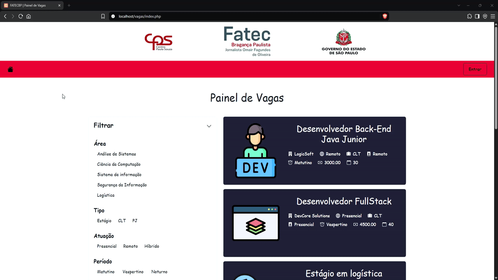
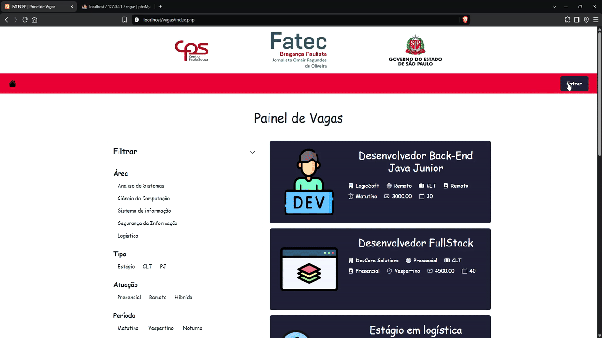
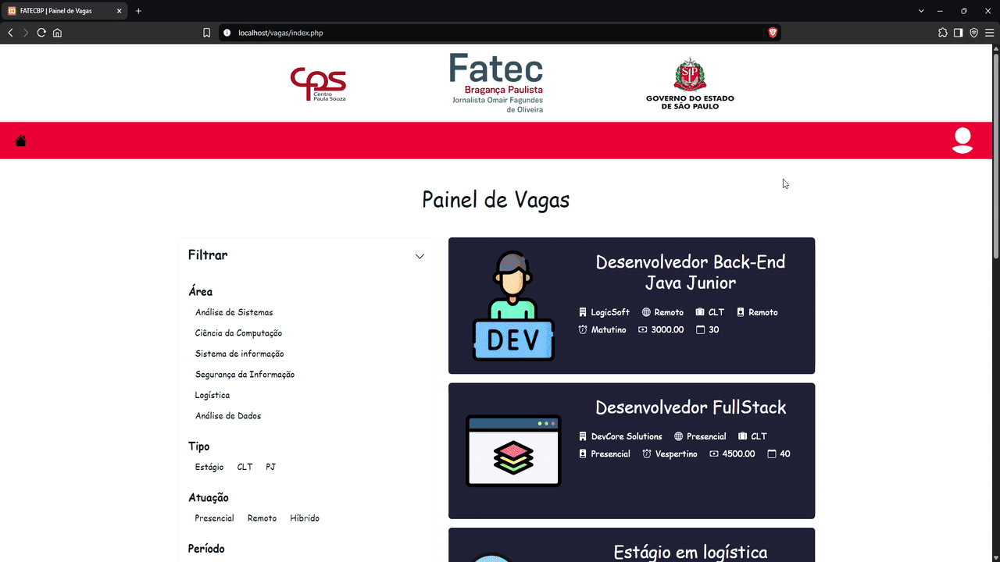
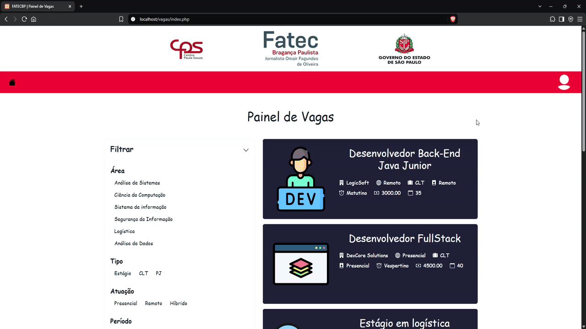

# Sistema de Vagas de Emprego

Projeto desenvolvido como experiência de estágio na **FATEC Bragança Paulista**, durante um período de 6 meses, em colaboração com outros 2 desenvolvedores/alunos.

O projeto consiste em uma plataforma de vagas de emprego na qual os alunos podem visualizar e filtrar as oportunidades de acordo com a **área de atuação, tipo de contratação, modalidade de trabalho  (presencial, remoto ou híbrido) e período (matutino, vespertino e noturno)**.

## 🚀 Funcionalidades

__Usuário__
* Visualizar as vagas disponíveis;
* Consultar os detalhes das vagas;
* Filtrar vagas por área, tipo de vaga, atuação e período.

__Administrador__

* Realizar login para acesso à área administrativa;
* Cadastrar vagas;
* Cadastrar áreas de atuação;
* Editar vagas;
* Excluir vagas;
* Gerenciar as informações das vagas;
* Realizar o upload de imagens relacionadas às vagas.

## 📸 Demonstração do sistema

### Página Inicial e filtros

### Login administrativo

### Cadastro de vaga

### Editar vaga

## 🛠️ Tecnologias utilizadas
* PHP
* JavaScript
* MySQL/MariaDB
* HTML5
* CSS3
* Bootstrap

